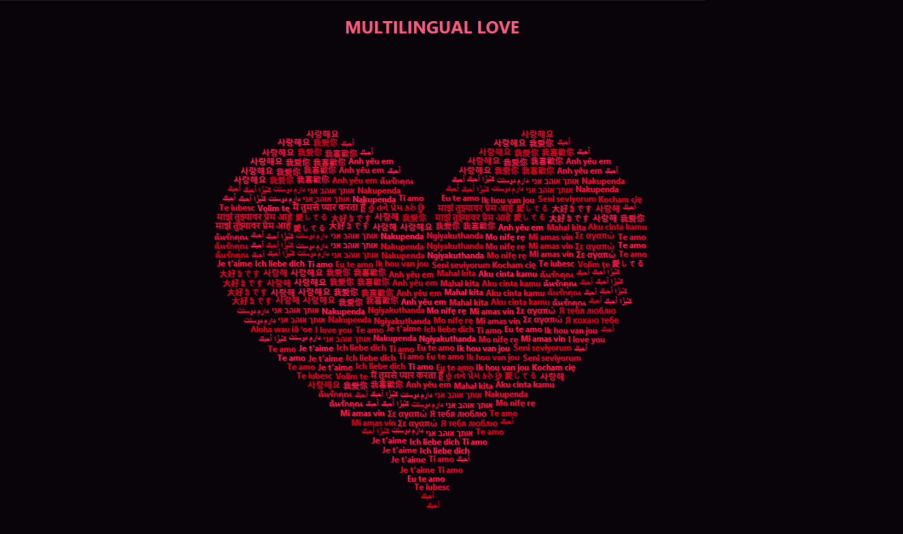

❤️ Multilingual Love Heart
A creative Python typography art project that transforms *“I love you”* into a beautiful animated heart using love phrases from languages around the world.

Featuring a dark background, glowing red text, gentle floating animations, and a shimmering effect, this project combines programming with digital art to create a unique visual experience.

Preview:



Features:

- **Heart-Shaped Typography** — Creates a heart silhouette using multilingual love phrases.
- **Multiple Languages** — Includes phrases in Hindi, Bengali, English, Japanese, Korean, Arabic, and many more.
- **Shimmering Text** — Adds a dynamic color-changing effect to the text.
- **Floating Animation** — Gives the text a gentle floating motion.
- **Dark Aesthetic** — Features a dark background with vibrant red and pink text.
- **Resizable Window** — Adjusts the heart layout when the application window is resized.
- **Pure Python**— Uses Python's built-in Tkinter library without requiring third-party packages.

Technologies Used:

- **Python 3** — Core programming language
- **Tkinter** — GUI and canvas rendering
- **Math** — Heart geometry and animation calculations
- **Random** — Animation variation and text placement

Getting Started

Prerequisites:

- Python 3.10 or later recommended
- A compatible desktop environment with Tkinter
- Fonts that support the languages you want to display

Installation:

1. Clone the repository

```bash
git clone https://github.com/kangnasync/Multilingual-Love-Heart.git
```

2. Navigate to the project folder

```bash
cd Multilingual-Love-Heart
```

3. On Windows, you can also try:

```bash
py love_heart.py
```
Project Structure:

```
Multilingual-Love-Heart/
├── love_heart.py
├── README.md
└── screenshots/
    └── love-heart.png
```

 What I Learned-

Building this project helped me explore:

- Drawing mathematical shapes using Python.
- Creating graphical interfaces with Tkinter.
- Animating canvas elements.
- Working with Unicode text and multilingual fonts.
- Combining programming logic with creative visual design.

Contributions:

Suggestions, ideas, and improvements are welcome. Feel free to fork the repository and experiment with your own creative version.

Author
Kangna Gupta

Made with ❤️ and Python.
